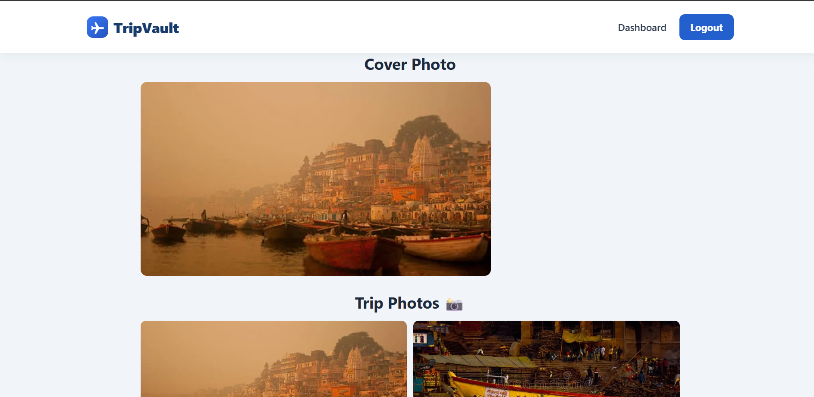
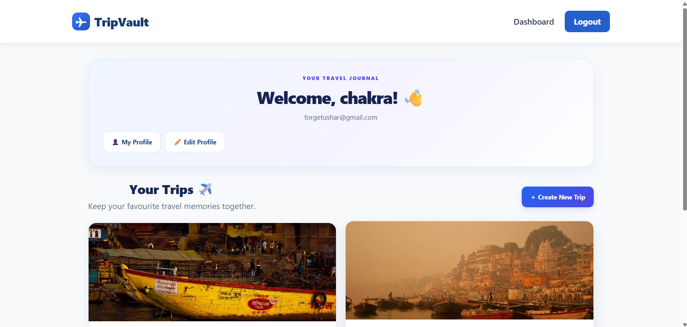
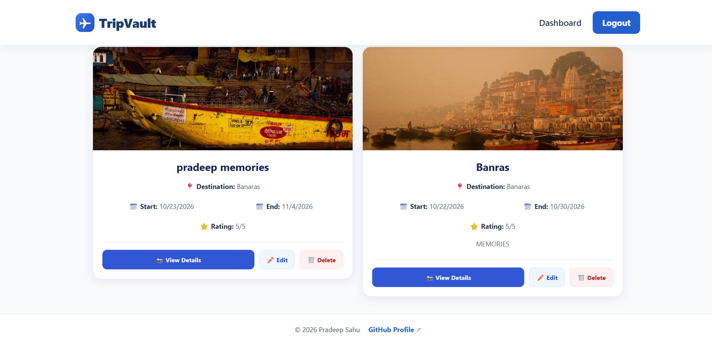
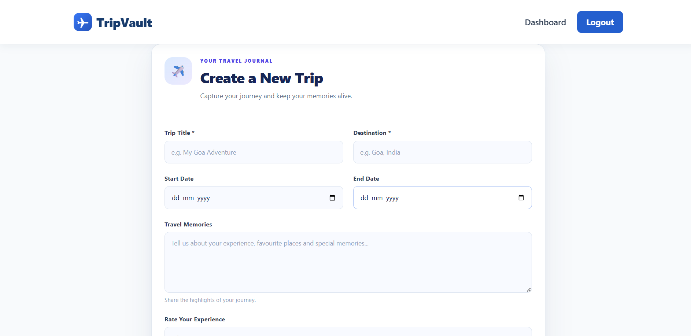
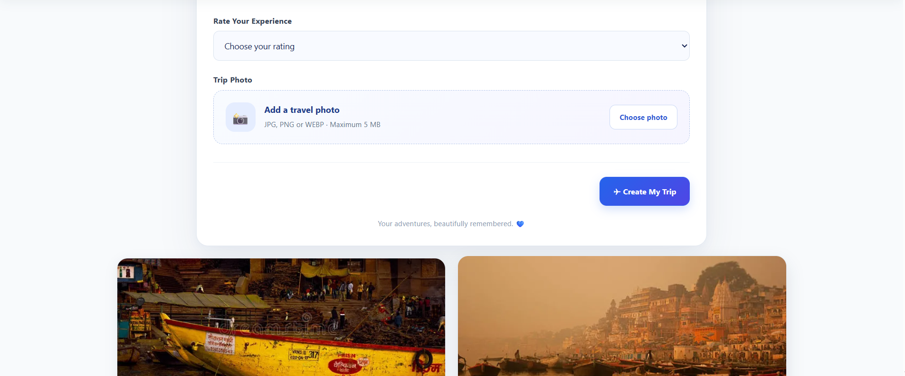

# ✈️ TripVault

A secure MERN stack travel memory journal application.

**TripVault** is a full-stack web application that allows users to create an account, securely log in, manage personal travel memories, upload trip photos, and maintain a public travel profile.

## 🌐 Live Demo

- **Frontend:** [https://tripvault-chi.vercel.app](https://tripvault-chi.vercel.app)
- **Backend:** [https://tripvault-a5ok.onrender.com](https://tripvault-a5ok.onrender.com)

## 🎯 Project Objective

The objective of TripVault is to provide users with a secure and user-friendly platform to manage and share their travel memories.

## 🚀 Features

### 🔐 Authentication

- User registration and login
- Unique username
- Password hashing using bcrypt
- JWT-based authentication
- Protected routes
- Personalized dashboard
- Logout functionality

### ✈️ Trip Management

- Create, view, edit, update, and delete trips
- Individual trip details page
- Trip title and destination
- Start and end dates
- Trip description and rating
- User-specific trip data
- Ownership validation for trip modifications
- Loading, error, and empty states
- Confirmation before deleting a trip

### 📸 Trip Photo Uploads

- Image uploads using Cloudinary
- Cover images for trips
- Multiple photos per trip
- Photo grids on trip details and public profiles
- Multer-based upload middleware
- Supported formats: JPG, JPEG, PNG, and WEBP
- Maximum image size: 5 MB

### 👤 Public Profiles

- Unique public username
- Public profile accessible without login
- Profile name and bio
- Public trip and photo grids
- Profile editing and bio updates
- Public API responses designed to avoid exposing private account fields

### 🎨 User Interface

- Responsive dashboard and trip cards
- Mobile-friendly layouts
- Navigation bar and footer
- Toast notifications for application feedback
- Loading indicators and error messages
- Responsive photo grids and forms

## 🛠️ Tech Stack

### Frontend

- React
- Vite
- JavaScript
- HTML5
- CSS3
- React Router DOM
- Axios

### Backend

- Node.js
- Express.js
- MongoDB
- Mongoose
- bcryptjs
- JSON Web Token (JWT)
- dotenv
- CORS
- Multer
- Cloudinary
- multer-storage-cloudinary

## 📁 Project Structure

```text
tripvault/
├── client/
│   ├── src/
│   │   ├── components/
│   │   │   ├── TripCard.jsx
│   │   │   └── TripForm.jsx
│   │   ├── pages/
│   │   │   ├── login.jsx
│   │   │   ├── register.jsx
│   │   │   ├── dashboard.jsx
│   │   │   ├── TripDetails.jsx
│   │   │   ├── PublicProfile.jsx
│   │   │   └── EditProfile.jsx
│   │   ├── App.jsx
│   │   └── main.jsx
│   ├── package.json
│   └── vite.config.js
├── server/
│   ├── middleware/
│   │   ├── authMiddleware.js
│   │   └── upload.js
│   ├── models/
│   │   ├── user.js
│   │   └── Trip.js
│   ├── routes/
│   │   ├── auth.js
│   │   ├── trips.js
│   │   └── profile.js
│   ├── index.js
│   └── package.json
├── .gitignore
└── README.md
```

## ⚙️ Installation and Setup

### Prerequisites

Install the following before running the project locally:

- Node.js and npm
- MongoDB database or a MongoDB Atlas account
- Cloudinary account for image uploads
- Git

### 1. Clone the Repository

```bash
git clone <YOUR_GITHUB_REPOSITORY_URL>
cd TripVault
```

Replace `<YOUR_GITHUB_REPOSITORY_URL>` with your actual GitHub repository URL.

### 2. Configure the Backend

```bash
cd server
npm install
```

Create a `.env` file inside the `server` folder and configure the required values:

```env
PORT=5000
MONGO_URI=your_mongodb_connection_string
JWT_SECRET=your_jwt_secret
CLOUDINARY_CLOUD_NAME=your_cloudinary_cloud_name
CLOUDINARY_API_KEY=your_cloudinary_api_key
CLOUDINARY_API_SECRET=your_cloudinary_api_secret
```

Use the exact environment variable names expected by your backend code. The names above are a template and must be verified against the actual implementation.

Start the backend using the script configured in `server/package.json`. For example, if the project defines a start script:

```bash
npm start
```

### 3. Configure the Frontend

Open a separate terminal:

```bash
cd client
npm install
```

Create a `.env` file inside `client`:

```env
VITE_API_URL=http://localhost:5000
```

Ensure the value matches the port and API configuration used by your backend.

Start the frontend using the script configured in `client/package.json`. For a standard Vite project:

```bash
npm run dev
```

Open the local URL displayed in the terminal.

### 4. Production Environment

For the deployed application, configure the frontend API URL and backend environment variables in the respective hosting dashboards.

- Frontend deployment: Vercel
- Backend deployment: Render
- Database: MongoDB
- Image storage: Cloudinary

Keep credentials and secret keys private. Never commit `.env` files containing real secrets to GitHub.

## 🔒 Security Considerations

- Password hashing
- JWT-based authentication
- Protected backend routes
- User-specific trip access
- Ownership checks for trip updates and deletion
- Public profile responses that avoid exposing sensitive account fields
- Environment-based configuration for secrets

## 🧪 Testing Checklist

- [ ] Register a new account
- [ ] Log in and log out
- [ ] Create a trip
- [ ] Edit and update a trip
- [ ] Delete a trip
- [ ] Upload and update trip images
- [ ] View trip details and public profiles
- [ ] Verify notifications and error handling
- [ ] Verify data persistence after refresh
- [ ] Test the live application on desktop and mobile

## 🚀 Future Improvements

- Advanced trip search and filtering
- Interactive travel maps
- Trip sharing and social interactions
- Travel statistics and personalized insights

## 👨‍💻 Author

**Pradeep Sahu**

- GitHub: [https://github.com/sahupradeep1910](https://github.com/sahupradeep1910)
- LinkedIn: [https://www.linkedin.com/in/pradeepsahu-it/](https://www.linkedin.com/in/pradeepsahu-it/)

## 📄 License

This project was developed for learning and portfolio purposes. Add a specific open-source license if you intend to distribute it under one.
## 📸 Project Screenshots

### Dashboard


### Trip Details



### Public Profile


### Profile_Creation

